  

  

  
  
  
  
   
  

### Hi there , I am David Lee.

I build worlds you can see. I come from **Unreal Engine** and real-time 3D, where light, cameras and whole worlds have to render in a fraction of a second. Today I work on **visualization** and on turning **single images into 3D worlds**, and I am moving into the **AI art** field.

## 🪐 Story Loom AI

  

I'm a developer at **[Story Loom AI](https://storyloomai.com)**, an AI-driven storytelling platform. My part is the visual one: making a story something you can see.

  

The story is written in the main app. These modules are where it is seen:

<table>
  <tr>
    <td width="33%" valign="top">
      <h3>🎬 <a href="https://previs.storyloomai.art">Previs</a></h3>
      Pre-visualization: scenes lit, framed and rendered like a film set before anything is final, using real-time techniques from game engines.
        
      
    </td>
    <td width="33%" valign="top">
      <h3>🌍 <a href="https://design.storyloomai.art">Scene Studio</a></h3>
      Image to 3D world: a single photo is read for depth, shape and light, then rebuilt as a 3D world you can move through and share.
        
      
    </td>
    <td width="33%" valign="top">
      <h3>🎨 <a href="https://comic.storyloomai.art">SLA Comic</a></h3>
      Story art: type a title, meet your characters, pick a story, and it is written and drawn as a webtoon or a printed comic book.
        
      
    </td>
  </tr>
</table>

  
  &nbsp;➜&nbsp;
  
  &nbsp;➜&nbsp;
  

<table>
  <tr>
    <td width="50%" valign="top">

### 🔭 I’m Currently Working On ...

* Building **Story Loom AI**, an AI-driven storytelling platform: its art, its rendering and its 3D worlds.
* Turning single images into 3D worlds you can explore.
* Real-time visualization of story scenes, on the web with three.js and in Unreal Engine 5.
* Crafting procedural, hyper-realistic environments that react to stories dynamically.
* Merging advanced game AI with cinematic, player-driven storytelling.

</td>
    <td width="50%" valign="top">

### 🌱 I’m Currently Learning ...

* Generative AI for art: keeping characters and style consistent from one scene to the next.
* Reading depth and shape from a single image and rebuilding it in 3D.
* Integrating real-time AI generation pipelines directly into Unreal Engine 5.
* Coaxing Nanite and Lumen into rendering trillion-polygon worlds.

</td>
  </tr>
</table>

## ⚡ Fun Facts Are ...

> 🔥 Building an app means running a massive, fire-breathing UE5 engine behind a polite Web UI. Users think it is magic; I know it is raw engineering.
>
> 🐛 When a web dev finds a bug, they change a line of CSS. When an Unreal dev finds a bug, we disappear into the C++ shadows for three days to fix a memory leak.
>
> 🎨 I spend days perfecting hyper-realistic environments and dynamic AI systems, just for testers to click "Next" and ask if the button can be a slightly different shade of blue.
>
> 🪐 One of our Story Loom AI pages renders a small solar system just to say hello. It is still lighter than one of my Unreal levels.

## 😄 Pronouns ...

* He / Him
* Director / Developer

## :hammer_and_wrench: My Main Skills Are ...  

<table align="center">
  <tr>
    <td align="center"  width="96">
      
       
    </td>
    <td align="center"  width="96">
      
       
    </td>     
    <td align="center"  width="96">
      
       
    </td>    
    <td align="center" width="96">
      
       
    </td>
    <td align="center" width="96">
      
       
    </td>
    <td align="center" width="96">
      
       
    </td>
  </tr>
  <tr>
    <td align="center" width="96">
      
       
    </td>
    <td align="center" width="96">
      
       
    </td>
    <td align="center"  width="96">
      
       
    </td>    
    <td align="center" width="96">
      
       
    </td>
    <td align="center" width="96">
      
       
    </td>
    <td align="center" width="96">
      
       
    </td>
  </tr>
  <tr>
    <td align="center" width="96">
      
       
    </td>
    <td align="center"  width="96">
      
       
    </td>
    <td align="center" width="96">
      
       
    </td>
    <td align="center" width="96">
      
       
    </td>
    <td align="center"  width="96">
      
       
    </td>
    <td align="center" width="96">
      
       
    </td> 
  </tr>
  <tr>
    <td align="center" width="96">
      
       
    </td>
    <td align="center" width="96">
      
       
    </td>
    <td align="center" width="96">
      
       
    </td>
    <td align="center" width="96">
      
       
    </td>
    <td align="center" width="96">
      
       
    </td>
    <td align="center" width="96">
      
       
    </td>
  </tr>
  <tr>
    <td align="center" width="96">
      
       
    </td>
    <td align="center" width="96">
      
       
    </td>
    <td align="center" width="96">
      
       
    </td>
    <td align="center" width="96">
      
       
    </td>
    <td align="center" width="96">
      
       
    </td>
    <td align="center" width="96">
      
       
    </td>
  </tr>
</table>
  

## 📊 My GitHub Stats Are ...

 

  

  

