  

  

  
  
  
  
   
  

### Hi there , I am David Lee.

I build worlds you can see. I come from **Unreal Engine** and real-time 3D, where light, cameras and whole worlds have to render in a fraction of a second. Today I work on **visualization** and on turning **single images into 3D worlds**, and I am moving into the **AI art** field.

## 🪐 Story Loom AI

I'm a developer at **[Story Loom AI](https://storyloomai.com)**, an AI-driven storytelling platform. My part is the visual one: making a story something you can see.

  

  

  

## ⚡ Fun Facts Are ...

> 🔥 Building an app means running a massive, fire-breathing UE5 engine behind a polite Web UI. Users think it is magic; I know it is raw engineering.
>
> 🐛 When a web dev finds a bug, they change a line of CSS. When an Unreal dev finds a bug, we disappear into the C++ shadows for three days to fix a memory leak.
>
> 🎨 I spend days perfecting hyper-realistic environments and dynamic AI systems, just for testers to click "Next" and ask if the button can be a slightly different shade of blue.
>
> 🪐 One of our Story Loom AI pages renders a small solar system just to say hello. It is still lighter than one of my Unreal levels.

## 😄 Pronouns ...

* He / Him
* Director / Developer

## :hammer_and_wrench: My Main Skills Are ...  

<table align="center">
  <tr>
    <td align="center"  width="96">
      
       
    </td>
    <td align="center"  width="96">
      
       
    </td>     
    <td align="center"  width="96">
      
       
    </td>    
    <td align="center" width="96">
      
       
    </td>
    <td align="center" width="96">
      
       
    </td>
    <td align="center" width="96">
      
       
    </td>
  </tr>
  <tr>
    <td align="center" width="96">
      
       
    </td>
    <td align="center" width="96">
      
       
    </td>
    <td align="center"  width="96">
      
       
    </td>    
    <td align="center" width="96">
      
       
    </td>
    <td align="center" width="96">
      
       
    </td>
    <td align="center" width="96">
      
       
    </td>
  </tr>
  <tr>
    <td align="center" width="96">
      
       
    </td>
    <td align="center"  width="96">
      
       
    </td>
    <td align="center" width="96">
      
       
    </td>
    <td align="center" width="96">
      
       
    </td>
    <td align="center"  width="96">
      
       
    </td>
    <td align="center" width="96">
      
       
    </td> 
  </tr>
  <tr>
    <td align="center" width="96">
      
       
    </td>
    <td align="center" width="96">
      
       
    </td>
    <td align="center" width="96">
      
       
    </td>
    <td align="center" width="96">
      
       
    </td>
    <td align="center" width="96">
      
       
    </td>
    <td align="center" width="96">
      
       
    </td>
  </tr>
  <tr>
    <td align="center" width="96">
      
       
    </td>
    <td align="center" width="96">
      
       
    </td>
    <td align="center" width="96">
      
       
    </td>
    <td align="center" width="96">
      
       
    </td>
    <td align="center" width="96">
      
       
    </td>
    <td align="center" width="96">
      
       
    </td>
  </tr>
</table>
  

## 📊 My GitHub Stats Are ...

 

  

  

  

